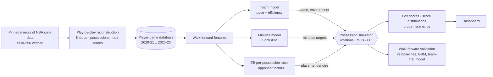

# NBA Quant Lab

**Simulate an NBA game possession by possession and get the final score *and* every player's box score - as
probability distributions that are internally consistent in every simulated game.**

NBA Quant Lab reconstructs six regular seasons (2020-21 .. 2025-26, 7,230 games) from raw play-by-play into a
player box-score database that matches the official NBA.com numbers, projects every player's minutes and
per-possession rates from pregame information only, and plays each game 20,000 times through a compiled possession
simulator with real five-man rotations, fouls, garbage time and overtime. From the joint simulations it prices player
props at any line (pushes included), double/triple-doubles and same-game combinations, and re-runs any matchup with
injuries, minutes limits or lineup changes. Everything is validated walk-forward against what actually happened.


## Results (walk-forward, test seasons 2024-25 and 2025-26)

Everything was tuned on 2023-24 and scored once on 2,460 test games / 52,865 player-games. Full tables:
[docs/REPORT.md](docs/REPORT.md) and the auto-generated [docs/FINDINGS_DATA.md](docs/FINDINGS_DATA.md).

1. **The box-score database is exact.** Player box scores derived from play-by-play match the official NBA.com box
   scores for 99.27% of 2023-24 player-games on every stat (minutes within 1 s for 99.97%, plus-minus 99.80%).
2. **Minutes are where accuracy is won.** A LightGBM minutes model with pregame teammate-absence features has MAE
   4.30 minutes vs 5.32 for season averages (-19%). A subtle leak - deep-bench appearances reveal blowouts - was found
   and removed.
3. **Point forecasts: simpler models are as good.** Gradient boosting (points MAE 4.380), closed-form empirical-Bayes
   rates (4.406) and the simulation (4.412) are within 0.7% of each other, all 5-6% better than season averages
   (4.667).
4. **Distributions: the simulation is the best calibrated.** For points and PRA - the lumpy, skewed statistics props
   are written on - the simulation's PIT calibration error is 0.04 / 0.08 vs 0.22 / 0.19 for negative-binomial
   distributions around the best point forecasts, and its 80% PRA intervals cover 79.7% vs 73.8%. It has the best
   or tied-best CRPS for rebounds, PRA, steals and turnovers.
5. **Team forecasts.** Player-level simulation alone is worse than the team model for spreads and totals; blended
   with it (weight chosen on 2023-24) it improves spreads significantly but slightly (RMSE 14.334 -> 14.292; 95% CI
   of the squared-error reduction +0.16 to +2.22) and leaves totals unchanged.
6. **Joint modelling matters.** Summing independently projected players misses the team forecast by 5.9 points on
   average and overstates team-score uncertainty by 40% (implied SD 18.6 vs realised 13.2): teammates share
   possessions. Every simulated game satisfies every box-score identity.
7. **Two data-backed mechanisms.** Shot shares grow super-linearly with usage (alpha = 1.3), and a player's true
   shooting falls 0.88 points per +10% relative usage (natural experiment via teammate absences; naive regression gets
   the sign wrong). Matchup (opponent) features help every stat but by about 0.1%.

| | Points MAE | Points CRPS | Points PIT error | PRA 80% coverage | Spread RMSE | Total RMSE |
|---|---:|---:|---:|---:|---:|---:|
| Season average | 4.667 | 3.387 | 0.246 | 72.4% | | |
| Gradient boosting | **4.380** | 3.128 | 0.218 | 73.8% | | |
| Possession simulation | 4.412 | 3.084 | **0.038** | **79.7%** | 14.514 | 18.662 |
| Team model | | | | | 14.334 | 18.484 |
| **Blend (team model + simulation)** | | | | | **14.292** | **18.474** |

**Live data.** The current 2026-27 season is not in the pinned sources and the NBA's CDN refused this environment, so
"upcoming games" are any as-of date's slate projected from earlier games only - exactly the pregame computation,
with the advantage that it can be checked against what happened ([docs/DATA.md](docs/DATA.md)).


## Quick start

```bash
git clone <this repo> && cd nba-quant-lab
python3 -m venv .venv && .venv/bin/pip install -e ".[dev]"     # Python 3.10+
```

```bash
make data        # download (pinned, SHA-256 verified) + reconstruct 6 seasons + database   (~3 min)
make models      # walk-forward features, team model, minutes, rates, opponent factors     (~5 min)
make backtest    # simulation backtests: 2023-24 -> blend weight -> blend; 2024-26 test    (~1.5 h, 4 cores)
make report      # baselines, GBM, matchup ablation, team-first model, summary, FINDINGS    (~15 min)
make dashboard   # http://localhost:8501
make test        # 37 tests
```

Project one game from the command line (only information available before tip-off is used):

```bash
.venv/bin/quantlab project --game-id 22501132 --n-sims 20000
```

```bash
.venv/bin/quantlab project --game-id 22501132 --out 1627759      # same game, Jaylen Brown ruled out
```

## Commands

| Command | What it does |
|---|---|
| `quantlab fetch` | Download the pinned play-by-play and box-score files (cached, checksum-verified). |
| `quantlab build` | Reconstruct each season: events, five-man lineups (stints), possessions, player and team box scores with on-court exposures, reconciliation against official box scores. |
| `quantlab database` | Unify seasons: `player_games`, `team_games`, `games`, `availability`, `players` (+ DuckDB views). |
| `quantlab features` | Walk-forward pregame feature store (decayed rates, minutes history, teammate absences). |
| `quantlab team` | Team model: walk-forward opponent-adjusted efficiency and pace ratings, spread/total distributions. |
| `quantlab minutes` | Minutes models (LightGBM vs baselines), per-season model files for scenarios. |
| `quantlab rates` / `opponent` | Empirical-Bayes per-possession player rates; team defensive/offensive style factors. |
| `quantlab constants` | Simulator structural constants from pre-test seasons (rotation templates, garbage time, possession time, late-game fouling). |
| `quantlab backtest` | Walk-forward simulation backtests (bottom-up and team-constrained). |
| `quantlab baselines` / `topdown` | Baselines + gradient boosting; the team-first reconciliation architecture. |
| `quantlab report` | `data/backtest/summary.json` and `docs/FINDINGS_DATA.md`. |
| `quantlab project` | Projected box scores, score distribution and a prop for one game; `--out` for scenarios. |
| `quantlab dashboard` | Streamlit dashboard. |
| `quantlab sql "SELECT ..."` | DuckDB over every processed table. |

## Architecture



```
src/quantlab/
  data/        sources, download, events, lineups, possessions, game (box scores + exposures), build, database
  features/    asof.py - walk-forward pregame feature store
  models/      team.py, minutes.py, rates.py, opponent.py
  sim/         core.py (numba kernel), engine.py (spec, calibration, invariants), inputs.py, props.py,
               scenario.py, constants.py
  eval/        backtest.py, baselines.py, topdown.py, report.py, writeup.py
  dashboard/   Streamlit app (slate, box score, player & props, scenario lab, comparison, validation, data)
  live.py      projection service (as-of-date slates, scenarios with minutes re-projection)
tests/         37 tests: PBP rules, leakage, simulator invariants, props, scenarios, review regressions
docs/          REPORT.md, METHODOLOGY.md, DATA.md, FINDINGS_DATA.md (auto-generated), screenshots
```

## Dashboard

| | |
|---|---|
|  **Slate**: every game on the as-of date with win probability, spread, total and the final score |  **Player detail & props**: distributions, any line (pushes on whole numbers), ladders with fair odds, double/triple-doubles, joint probabilities |
|  **Scenario lab**: rule players out, change minutes, starters, availability or usage; compare with common random numbers |  **Player comparison**: per-36 production, recent form and overlaid projected distributions |

The Validation page shows the backtest evidence below; the Data & methods page shows the reconciliation against
official box scores.

## Documentation

* [docs/REPORT.md](docs/REPORT.md) - results and conclusions
* [docs/METHODOLOGY.md](docs/METHODOLOGY.md) - every rule, model, parameter and what it was fitted on
* [docs/DATA.md](docs/DATA.md) - sources, checksums, coverage, reconciliation, the live-data limitation
* [docs/FINDINGS_DATA.md](docs/FINDINGS_DATA.md) - auto-generated tables behind every number

## Data and licensing

Play-by-play: NBA liveData feed via [shufinskiy/nba_data](https://github.com/shufinskiy/nba_data) (Apache-2.0). Box
scores: NBA.com via [NocturneBear/NBA-Data-2010-2024](https://github.com/NocturneBear/NBA-Data-2010-2024) (MIT).
Both pinned to exact commits. The statistics belong to the NBA (NBA.com Terms of Use: personal, non-commercial use);
raw and processed data are not committed. Code: MIT.
