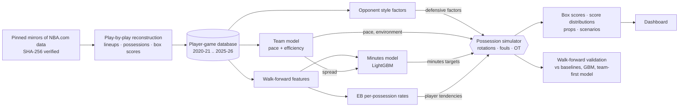

# NBA Quant Lab

**Simulate an NBA game possession by possession and get the final score *and* every player's box score - as
probability distributions that are internally consistent in every simulated game.**

NBA Quant Lab reconstructs six regular seasons (2020-21 .. 2025-26, 7,230 games) from raw play-by-play into a
player box-score database that matches the official NBA.com box scores on every counting stat for 97-99% of
player-games where they exist (2020-24), projects every player's minutes and per-possession rates walk-forward from
earlier games and the starting five (availability is taken from who appeared, a stand-in for the inactive list; see
Results 2), and plays each game 20,000 times (the projection default; the walk-forward backtests behind the results
use 1,200 simulations per game) through a compiled possession simulator with real five-man rotations, fouls, garbage
time and overtime. From the joint simulations it prices player
props at any line (pushes included), double/triple-doubles and same-game combinations, and re-runs any matchup with
injuries, minutes limits or lineup changes. Everything is validated walk-forward against what actually happened.
For the current season (2026-27) it fetches the games played so far from the NBA's live feed and projects every
upcoming game truly pregame, from projected starting fives and availability.


## Results (walk-forward, test seasons 2024-25 and 2025-26)

Everything was tuned on 2023-24; the final version was scored, with everything frozen, on
2,460 test games / 52,947 player-games (earlier versions had also been
scored on them before the review fixes). Full tables: [docs/REPORT.md](docs/REPORT.md) and the auto-generated
[docs/FINDINGS_DATA.md](docs/FINDINGS_DATA.md). An adversarial review of the first version found errors that flattered
some results; they were fixed - except the who-appeared availability stand-in, which cannot be fixed for the test
seasons and is measured instead (item 2), and overtime frequency, fixed only partly - and everything was re-run
(REPORT, "What an adversarial review changed").

1. **The box-score database is near-exact where it can be checked.** Player box scores derived from play-by-play match
   the official NBA.com box scores on every counting stat for 99.27% of 2023-24
   player-games (minutes within 1 s for 99.97%, plus-minus
   99.80%) and for 97.4-99.1% in 2020-23; 2024-25 and 2025-26
   have no official box scores to check against.
2. **Minutes are where accuracy is won.** A LightGBM minutes model with pregame teammate-absence features and the
   announced starting five has MAE 4.30 minutes vs 5.32 for season averages
   (19% better; 4.44, 16.5% better, without lineup information). Who is available is
   taken from who appeared (the sources have no inactive list for the test seasons), which also reveals rotation
   players a coach chose not to use; on 2023-24, where the official list exists, it flatters the minutes model by
   0.066 minutes (1.5%). A second leak - deep-bench appearances reveal
   blowouts - was found and removed.
3. **Point forecasts: gradient boosting has the lowest MAE, the others are close** (on RMSE the team-first
   reconciliation is lowest for points and PRA). Points MAE: gradient boosting
   4.376, team-first reconciliation 4.386, simulation 4.408, closed-form
   empirical-Bayes rates 4.402; season averages 4.663. Most of the gain is projected minutes
   (per-minute rates x projected minutes alone: 4.444).
4. **Distributions: the simulation is best calibrated for points, not better overall.** Against negative-binomial
   distributions with a mean-dependent dispersion around the same point forecasts, the simulation's points PIT error is
   0.034 vs 0.122 and it has the best points log score, but CRPS is a
   near tie for points (team-first 3.069, gradient boosting 3.074, simulation 3.080, empirical-Bayes rates 3.089) and favours gradient boosting for PRA (3.995 vs
   4.016). Simulated over/under probabilities at the line nearest the projection are on
   average within 0.75 percentage points of the observed over rate for points, PRA, steals, turnovers
   (within probability deciles the gaps reach +4.5 points for points and
   +5.5 for PRA), and overstated for rebounds +3.5, blocks +2.9, threes +1.9, assists +1.8 points.
5. **Team forecasts: level with the team model.** The shipped simulation (team-model weight 0.75 in its efficiency target) has
   spread RMSE 14.305 vs 14.334 for the team model (squared-error gain +0.82 (95% CI -0.68 to +2.41)) and total RMSE
   18.496 vs 18.484 (-0.43 (95% CI -2.24 to +1.45)): neither difference is significant. The bottom-up simulation alone is significantly
   worse on both. A post-hoc 75/25 weighted average of team-model and bottom-up means (the
   blend weight chosen on 2023-24) does improve spreads (+1.24 (95% CI +0.22 to +2.22)), so player-level information
   carries some signal the team model lacks, but the
   simulator's value is the consistent joint box score rather than a better score forecast.
6. **Joint modelling matters.** Summing independently projected players misses the team forecast by
   5.9 points on average and overstates team-score uncertainty by
   42% (implied SD 18.7 vs realised
   13.2): teammates share possessions. Every simulated game satisfies every box-score
   identity (checked on each backtest game).
7. **Two data-backed mechanisms; matchups help a little.** Shot shares grow super-linearly with usage (alpha = 1.3),
   and a player's true shooting falls 0.88 points per +10% relative usage (natural experiment via teammate absences;
   naive regression gets the sign wrong). Opponent information improves every statistic, by
   0.1-0.5% of MAE.

| | Points MAE | Points CRPS | Points PIT error | PRA CRPS | Spread RMSE | Total RMSE |
|---|---:|---:|---:|---:|---:|---:|
| Season average | 4.663 | 3.334 | 0.165 | 4.468 | | |
| Gradient boosting | 4.376 | 3.074 | 0.122 | 3.995 | | |
| Team-first reconciliation | 4.386 | 3.069 | 0.116 | 4.021 | | |
| **Possession simulation (shipped blend)** | 4.408 | 3.080 | 0.034 | 4.016 | 14.305 | 18.496 |
| Team model | | | | | 14.334 | 18.484 |

**Upcoming games (current season).** Unplayed games are projected truly pregame - nothing from the game itself:
the starting five is projected (the team's last one), availability comes from missed-game streaks (there is no injury
feed; the injury report can be entered in the dashboard) and minutes from the lineup-blind model. Rehearsed on
2025-26 through the live feed's format and the real update pipeline, with every game from 2026-01-15 on
hidden, the 53 games of the following 7 days had minutes MAE 4.92
against 4.10 for the backtest's projections of the same games, which know who appeared and who
started (+20%), points 4.56 against 4.33 (+5%) and PRA
5.93 against 5.49 (+8%), on the 1,096 of the
1,152 player-games both projected. The other 56 appearances
(3.8% of the minutes) were by players the pregame projection left out -
presumed out after missing three games, or not in the team's 25-day pool; counted as projected 0 they raise its MAE to
5.51 minutes and 4.76 points. 4.0 of 5 projected starters started and
16% of the projected rotation players did not play. Spread and total
RMSE were within 0.12 points of the backtest simulation's and the team model's (53 games
are too few to tell them apart). The
backtest results above are therefore optimistic for a real slate, mostly through minutes
([docs/pregame_rehearsal.json](docs/pregame_rehearsal.json), [METHODOLOGY](docs/METHODOLOGY.md) section 11).

## Quick start

```bash
git clone https://github.com/leoleejbjb/nba-quant-lab && cd nba-quant-lab
python3 -m venv .venv && .venv/bin/pip install -e ".[dev]"     # Python 3.10 - 3.13
```

```bash
make data        # download (pinned, SHA-256 verified) + reconstruct 6 seasons + database   (~3 min)
make models      # walk-forward features, team model, minutes, rates, opponent factors, simulator constants   (~5 min)
make backtest    # simulation backtests: 2023-24 -> blend weight -> blend; 2024-26 test    (~1.5 h, 4 cores)
make report      # baselines, GBM, matchup ablation, team-first model, summary, FINDINGS    (~15 min)
make docs        # re-render README results, docs/REPORT.md and docs/report.html from the summary
make dashboard   # http://localhost:8501
make test        # 69 tests (the slow end-to-end rehearsal test runs with QUANTLAB_SLOW_TESTS=1)
```

**Current season.** After the pipeline has run once (`make data models` is enough to start; `make backtest` chooses
the blend weight, 0.5 until then), `make live` fetches the 2026-27 schedule and the play-by-play of every finished
game from cdn.nba.com, rebuilds the season and refreshes features and models with the fitted parameters (a few
minutes the first time; later runs fetch only new games). Run it whenever new games have been played, then:

```bash
make live                                    # = .venv/bin/quantlab live-update
.venv/bin/quantlab slate --date today        # every player's projected line for today's games -> projections_<date>.csv
.venv/bin/quantlab project --game-id <id>    # one upcoming game: box score, score distribution, projected starters
make dashboard                               # opens on the next unplayed date; enter the injury report on the Slate
```

The game ids are printed by `quantlab slate`. There is no injury feed: a rotation player who missed his team's last
three games is presumed out, the other rotation players play with their missed-game streak's appearance rate and
deep-bench players with their share of the team's recent games, so mark the official
injury report on the Slate page (or in `data/live_overrides.json`, METHODOLOGY section 11) before projecting: players
out, and players back - from a short or a long absence. Each change re-projects the teammates' minutes and acts on
the team's projection the way a Scenario-lab change does. Requests to cdn.nba.com
identify the program honestly and are never retried under another identity; if the CDN refuses a machine (cloud
machines are often refused - this build environment was), the update stops with a message.

**Windows (PowerShell).** `make.ps1` runs the same targets. Install [Git](https://git-scm.com/download/win), the
[Microsoft Visual C++ Redistributable (x64)](https://aka.ms/vs/17/release/vc_redist.x64.exe) (numba and LightGBM need
it; many PCs already have it) and Python 3.13 from python.org - the Windows installer (64-bit), with "Add python.exe to
PATH" ticked (3.10 - 3.13 work; 3.14 does not, because numpy < 2.3 has no wheels for it). Then:

```powershell
git clone https://github.com/leoleejbjb/nba-quant-lab
cd nba-quant-lab
Set-ExecutionPolicy -Scope Process -ExecutionPolicy Bypass -Force   # let this window run local scripts
.\make.ps1 install
.\make.ps1 all          # data, models, backtest, report (~2 h on 4 cores, ~1 GB of disk)
.\make.ps1 dashboard    # http://localhost:8501
```

`.\make.ps1 help` lists every target; `.\make.ps1 quantlab <command> [options]` runs any `quantlab` command (for
example `.\make.ps1 quantlab project --game-id 22501132`). For the current season:

```powershell
.\make.ps1 live                               # fetch new 2026-27 games, rebuild, refresh
.\make.ps1 quantlab slate --date today        # projections_<date>.csv
.\make.ps1 dashboard
```

Project a finished game from the command line, as backtested (earlier games and the starting five, with availability
taken from who appeared in the game, the inactive-list stand-in described in Results 2):

```bash
.venv/bin/quantlab project --game-id 22501132 --n-sims 20000
```

```bash
.venv/bin/quantlab project --game-id 22501132 --out 1627759      # same game, Jaylen Brown ruled out
```

## Commands

| Command | What it does |
|---|---|
| `quantlab fetch` | Download the pinned play-by-play and box-score files (cached, checksum-verified). |
| `quantlab build` | Reconstruct each season: events, five-man lineups (stints), possessions, player and team box scores with on-court exposures, reconciliation against official box scores. |
| `quantlab database` | Unify seasons: `player_games`, `team_games`, `games`, `availability`, `players` (+ DuckDB views). |
| `quantlab features` | Walk-forward pregame feature store (decayed rates, minutes history, teammate absences). |
| `quantlab team` | Team model: walk-forward opponent-adjusted efficiency and pace ratings, spread/total distributions. |
| `quantlab minutes` | Minutes models (LightGBM vs baselines), per-season model files for scenarios, and the inactive-list experiment (what the appearance stand-in for availability is worth, 2023-24). |
| `quantlab rates` / `opponent` | Empirical-Bayes per-possession player rates; team defensive/offensive style factors. |
| `quantlab constants` | Simulator structural constants from pre-test seasons (rotation templates, garbage time, possession time, late-game fouling). |
| `quantlab backtest` | Walk-forward simulation backtests (`--modes none,team,blend`: bottom-up, team-constrained, shipped blend); every simulated game is checked against the box-score identities. |
| `quantlab blendweight` | Choose the blend's team-model weight on the tuning season (`data/models/integration.json`). |
| `quantlab baselines` / `ablation` / `topdown` | Baselines + gradient boosting; the nested matchup ablation; the team-first reconciliation architecture. |
| `quantlab report` | `data/backtest/summary.json` and `docs/FINDINGS_DATA.md`. |
| `quantlab project` | Projected box scores, score distribution and a prop for one game (an upcoming game is projected pregame); `--out` for scenarios. |
| `quantlab live-update` | Current season: fetch new games from cdn.nba.com (`--skip-fetch` rebuilds from the files already fetched), rebuild the season, refresh features and models with the fitted parameters, give the next 10 days' games pregame inputs. |
| `quantlab slate` | Every player's projected line (mean and 10th-90th percentile) for all games on a date, as a CSV (`--date today`). |
| `quantlab dashboard` | Streamlit dashboard. |
| `quantlab sql "SELECT ..."` | DuckDB over every processed table. |

## Architecture



```
src/quantlab/
  data/        sources, download, cdn (current-season fetcher), events, lineups, possessions, game (box scores +
               exposures), build, database, warehouse (DuckDB views for `quantlab sql`)
  features/    asof.py - walk-forward pregame feature store (incl. pregame deep-bench candidates, availability variants)
  models/      team.py, minutes.py, rates.py, opponent.py
  sim/         core.py (numba kernel), engine.py (spec, calibration, invariants), inputs.py, props.py,
               scenario.py, constants.py
  eval/        backtest.py, baselines.py, topdown.py, report.py, writeup.py, pregame.py (current-season rehearsal)
  dashboard/   Streamlit app (slate, box score, player & props, scenario lab, comparison, validation, data)
  live.py      projection service (slates of finished and upcoming games, injury report, scenarios with minutes
               re-projection)
  cli.py, config.py   command line; paths, seasons and the tuning/test split
scripts/       run_backtests.py, rehearse_live.py (the current-season rehearsal), make_report_page.py
               (docs/report.html), docs/ (README results and REPORT renderers), package.sh
tests/         69 tests: PBP rules, leakage, simulator invariants, props, scenarios, the live feed, the rehearsal,
               review regressions
Makefile, make.ps1   pipeline targets (make on Linux/macOS, PowerShell on Windows)
docs/          REPORT.md, METHODOLOGY.md, DATA.md, FINDINGS_DATA.md (auto-generated), screenshots
```

## Dashboard

| | |
|---|---|
|  **Slate**: every game on a date (upcoming ones projected pregame, with an injury report) with win probability, spread, total and the final score or tip-off time |  **Player detail & props**: distributions, any line (pushes on whole numbers), ladders with fair odds, double/triple-doubles, joint probabilities |
|  **Scenario lab**: rule players out, change minutes, starters, availability or usage; compare with common random numbers |  **Player comparison**: per-36 production, recent form and overlaid projected distributions |
|  **Validation**: the backtest tables and charts behind the results above, for the test or tuning seasons |  **Projected box score** (also at the top): every player's projected line, with 80% ranges in a second tab; win probability, spread, total and overtime |

The Validation page shows the backtest evidence summarised above (Results); the Data & methods page shows the
reconciliation against official box scores.

## Documentation

* [docs/REPORT.md](docs/REPORT.md) - results and conclusions
* [docs/METHODOLOGY.md](docs/METHODOLOGY.md) - every rule, model, parameter and what it was fitted on
* [docs/DATA.md](docs/DATA.md) - sources, checksums, coverage, reconciliation, the current-season feed
* [docs/FINDINGS_DATA.md](docs/FINDINGS_DATA.md) - auto-generated tables behind most of the numbers above (the
  usage exponent and the usage-efficiency estimate are documented in REPORT and METHODOLOGY only)

## Data and licensing

Play-by-play: NBA liveData feed via [shufinskiy/nba_data](https://github.com/shufinskiy/nba_data) (Apache-2.0). Box
scores: NBA.com via [NocturneBear/NBA-Data-2010-2024](https://github.com/NocturneBear/NBA-Data-2010-2024) (MIT).
Both pinned to exact commits. The statistics belong to the NBA (NBA.com Terms of Use: personal, non-commercial use);
raw and processed data are not committed. Code: MIT.
