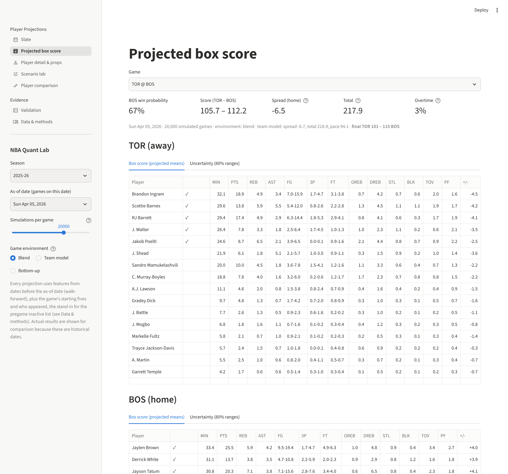
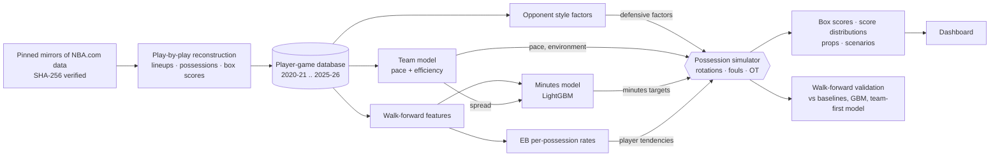
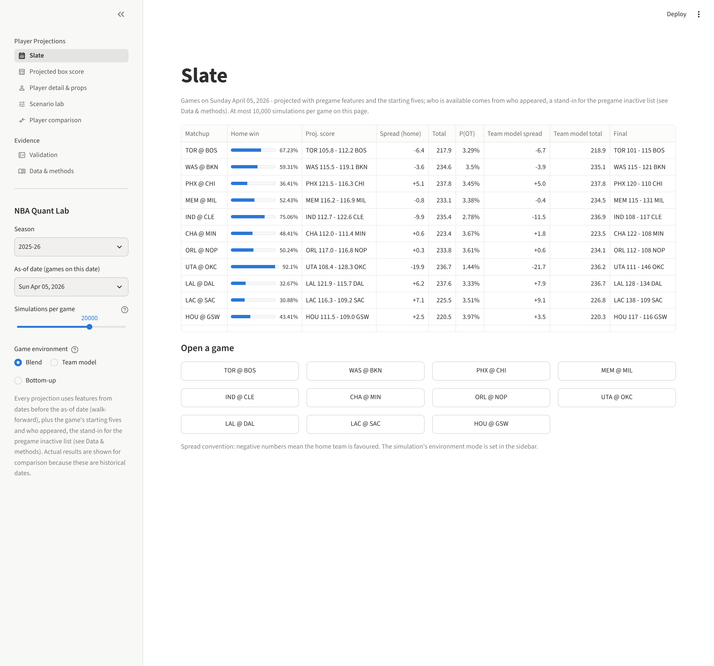
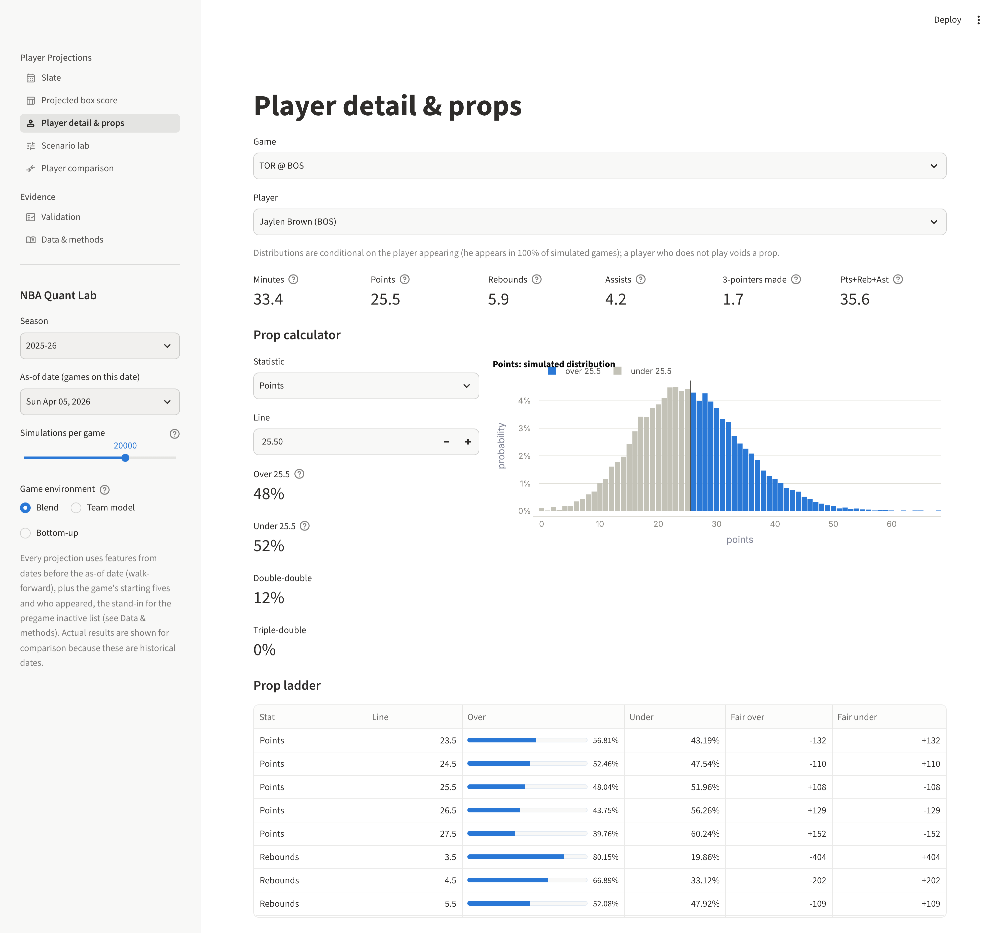
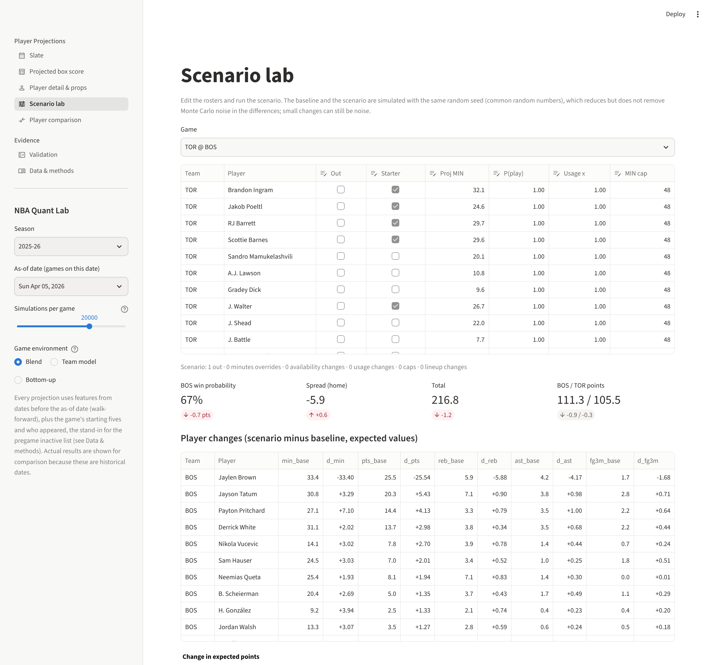
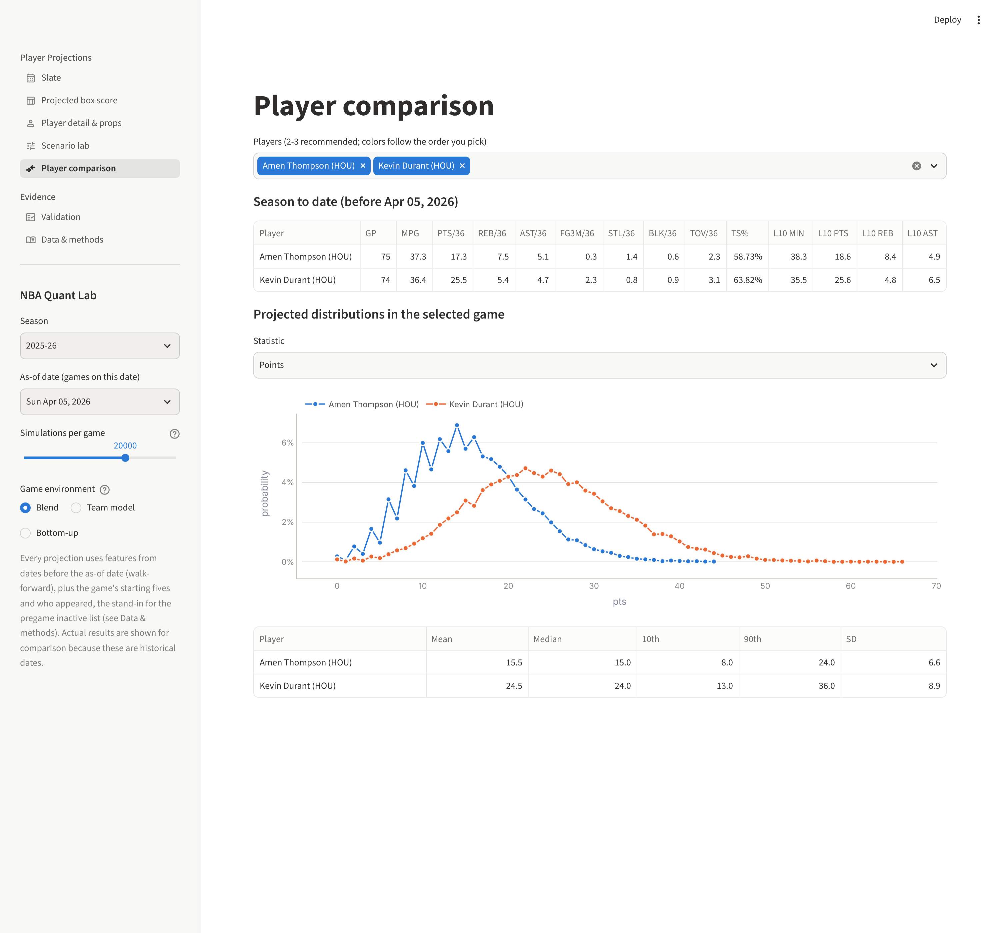
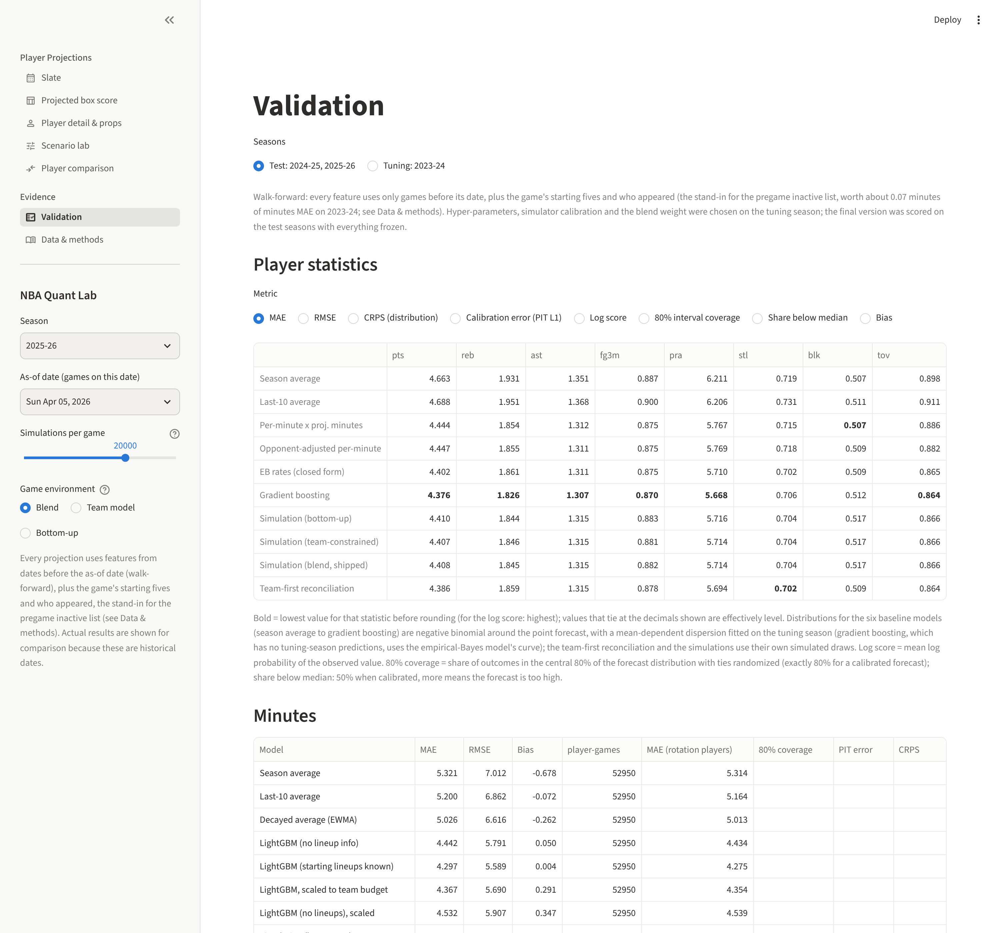

# NBA Quant Lab

**Simulate an NBA game possession by possession and get the final score *and* every player's box score - as
probability distributions that are internally consistent in every simulated game.**

NBA Quant Lab reconstructs six regular seasons (2020-21 .. 2025-26, 7,230 games) from raw play-by-play into a
player box-score database that matches the official NBA.com box scores on every counting stat for 97-99% of
player-games where they exist (2020-24), projects every player's minutes and per-possession rates walk-forward from
earlier games and the starting five (availability is taken from who appeared, a stand-in for the inactive list; see
Results 2), and plays each game 20,000 times (the projection default; the walk-forward backtests behind the results
use 1,200 simulations per game) through a compiled possession simulator with real five-man rotations, fouls, garbage
time and overtime. From the joint simulations it prices player
props at any line (pushes included), double/triple-doubles and same-game combinations, and re-runs any matchup with
injuries, minutes limits or lineup changes. Everything is validated walk-forward against what actually happened.



## Results (walk-forward, test seasons 2024-25 and 2025-26)

Everything was tuned on 2023-24; the final version was scored, with everything frozen, on
2,460 test games / 52,947 player-games (earlier versions had also been
scored on them before the review fixes). Full tables: [docs/REPORT.md](docs/REPORT.md) and the auto-generated
[docs/FINDINGS_DATA.md](docs/FINDINGS_DATA.md). An adversarial review of the first version found errors that flattered
some results; they were fixed - except the who-appeared availability stand-in, which cannot be fixed for the test
seasons and is measured instead (item 2), and overtime frequency, fixed only partly - and everything was re-run
(REPORT, "What an adversarial review changed").

1. **The box-score database is near-exact where it can be checked.** Player box scores derived from play-by-play match
   the official NBA.com box scores on every counting stat for 99.27% of 2023-24
   player-games (minutes within 1 s for 99.97%, plus-minus
   99.80%) and for 97.4-99.1% in 2020-23; 2024-25 and 2025-26
   have no official box scores to check against.
2. **Minutes are where accuracy is won.** A LightGBM minutes model with pregame teammate-absence features and the
   announced starting five has MAE 4.30 minutes vs 5.32 for season averages
   (19% better; 4.44, 16.5% better, without lineup information). Who is available is
   taken from who appeared (the sources have no inactive list for the test seasons), which also reveals rotation
   players a coach chose not to use; on 2023-24, where the official list exists, it flatters the minutes model by
   0.066 minutes (1.5%). A second leak - deep-bench appearances reveal
   blowouts - was found and removed.
3. **Point forecasts: gradient boosting has the lowest MAE, the others are close** (on RMSE the team-first
   reconciliation is lowest for points and PRA). Points MAE: gradient boosting
   4.376, team-first reconciliation 4.386, simulation 4.408, closed-form
   empirical-Bayes rates 4.402; season averages 4.663. Most of the gain is projected minutes
   (per-minute rates x projected minutes alone: 4.444).
4. **Distributions: the simulation is best calibrated for points, not better overall.** Against negative-binomial
   distributions with a mean-dependent dispersion around the same point forecasts, the simulation's points PIT error is
   0.034 vs 0.122 and it has the best points log score, but CRPS is a
   near tie for points (team-first 3.069, gradient boosting 3.074, simulation 3.080, empirical-Bayes rates 3.089) and favours gradient boosting for PRA (3.995 vs
   4.016). Simulated over/under probabilities at the line nearest the projection are on
   average within 0.75 percentage points of the observed over rate for points, PRA, steals, turnovers
   (within probability deciles the gaps reach +4.5 points for points and
   +5.5 for PRA), and overstated for rebounds +3.5, blocks +2.9, threes +1.9, assists +1.8 points.
5. **Team forecasts: level with the team model.** The shipped simulation (team-model weight 0.75 in its efficiency target) has
   spread RMSE 14.305 vs 14.334 for the team model (squared-error gain +0.82 (95% CI -0.68 to +2.41)) and total RMSE
   18.496 vs 18.484 (-0.43 (95% CI -2.24 to +1.45)): neither difference is significant. The bottom-up simulation alone is significantly
   worse on both. A post-hoc 75/25 weighted average of team-model and bottom-up means (the
   blend weight chosen on 2023-24) does improve spreads (+1.24 (95% CI +0.22 to +2.22)), so player-level information
   carries some signal the team model lacks, but the
   simulator's value is the consistent joint box score rather than a better score forecast.
6. **Joint modelling matters.** Summing independently projected players misses the team forecast by
   5.9 points on average and overstates team-score uncertainty by
   42% (implied SD 18.7 vs realised
   13.2): teammates share possessions. Every simulated game satisfies every box-score
   identity (checked on each backtest game).
7. **Two data-backed mechanisms; matchups help a little.** Shot shares grow super-linearly with usage (alpha = 1.3),
   and a player's true shooting falls 0.88 points per +10% relative usage (natural experiment via teammate absences;
   naive regression gets the sign wrong). Opponent information improves every statistic, by
   0.1-0.5% of MAE.

| | Points MAE | Points CRPS | Points PIT error | PRA CRPS | Spread RMSE | Total RMSE |
|---|---:|---:|---:|---:|---:|---:|
| Season average | 4.663 | 3.334 | 0.165 | 4.468 | | |
| Gradient boosting | 4.376 | 3.074 | 0.122 | 3.995 | | |
| Team-first reconciliation | 4.386 | 3.069 | 0.116 | 4.021 | | |
| **Possession simulation (shipped blend)** | 4.408 | 3.080 | 0.034 | 4.016 | 14.305 | 18.496 |
| Team model | | | | | 14.334 | 18.484 |

**Live data.** The current 2026-27 season is not in the pinned sources and the NBA's CDN refused this environment, so
"upcoming games" are the slate of any as-of date in 2023-24 .. 2025-26, projected from earlier games plus that game's
starting five and who appeared (the inactive-list stand-in, Results 2) - the same inputs and simulator as the
backtest - with the advantage that it can be checked against what happened ([docs/DATA.md](docs/DATA.md)).

## Quick start

```bash
git clone <this repo> && cd nba-quant-lab
python3 -m venv .venv && .venv/bin/pip install -e ".[dev]"     # Python 3.10+
```

```bash
make data        # download (pinned, SHA-256 verified) + reconstruct 6 seasons + database   (~3 min)
make models      # walk-forward features, team model, minutes, rates, opponent factors, simulator constants   (~5 min)
make backtest    # simulation backtests: 2023-24 -> blend weight -> blend; 2024-26 test    (~1.5 h, 4 cores)
make report      # baselines, GBM, matchup ablation, team-first model, summary, FINDINGS    (~15 min)
make docs        # re-render README results, docs/REPORT.md and docs/report.html from the summary
make dashboard   # http://localhost:8501
make test        # 38 tests
```

Project one game from the command line (pregame inputs - earlier games and the starting five - except that
availability is taken from who appeared in the game, the inactive-list stand-in described in Results 2):

```bash
.venv/bin/quantlab project --game-id 22501132 --n-sims 20000
```

```bash
.venv/bin/quantlab project --game-id 22501132 --out 1627759      # same game, Jaylen Brown ruled out
```

## Commands

| Command | What it does |
|---|---|
| `quantlab fetch` | Download the pinned play-by-play and box-score files (cached, checksum-verified). |
| `quantlab build` | Reconstruct each season: events, five-man lineups (stints), possessions, player and team box scores with on-court exposures, reconciliation against official box scores. |
| `quantlab database` | Unify seasons: `player_games`, `team_games`, `games`, `availability`, `players` (+ DuckDB views). |
| `quantlab features` | Walk-forward pregame feature store (decayed rates, minutes history, teammate absences). |
| `quantlab team` | Team model: walk-forward opponent-adjusted efficiency and pace ratings, spread/total distributions. |
| `quantlab minutes` | Minutes models (LightGBM vs baselines), per-season model files for scenarios, and the inactive-list experiment (what the appearance stand-in for availability is worth, 2023-24). |
| `quantlab rates` / `opponent` | Empirical-Bayes per-possession player rates; team defensive/offensive style factors. |
| `quantlab constants` | Simulator structural constants from pre-test seasons (rotation templates, garbage time, possession time, late-game fouling). |
| `quantlab backtest` | Walk-forward simulation backtests (`--modes none,team,blend`: bottom-up, team-constrained, shipped blend); every simulated game is checked against the box-score identities. |
| `quantlab blendweight` | Choose the blend's team-model weight on the tuning season (`data/models/integration.json`). |
| `quantlab baselines` / `ablation` / `topdown` | Baselines + gradient boosting; the nested matchup ablation; the team-first reconciliation architecture. |
| `quantlab report` | `data/backtest/summary.json` and `docs/FINDINGS_DATA.md`. |
| `quantlab project` | Projected box scores, score distribution and a prop for one game; `--out` for scenarios. |
| `quantlab dashboard` | Streamlit dashboard. |
| `quantlab sql "SELECT ..."` | DuckDB over every processed table. |

## Architecture



```
src/quantlab/
  data/        sources, download, events, lineups, possessions, game (box scores + exposures), build, database,
               warehouse (DuckDB views for `quantlab sql`)
  features/    asof.py - walk-forward pregame feature store (incl. pregame deep-bench candidates, availability variants)
  models/      team.py, minutes.py, rates.py, opponent.py
  sim/         core.py (numba kernel), engine.py (spec, calibration, invariants), inputs.py, props.py,
               scenario.py, constants.py
  eval/        backtest.py, baselines.py, topdown.py, report.py, writeup.py
  dashboard/   Streamlit app (slate, box score, player & props, scenario lab, comparison, validation, data)
  live.py      projection service (as-of-date slates, scenarios with minutes re-projection)
  cli.py, config.py   command line; paths, seasons and the tuning/test split
scripts/       run_backtests.py, make_report_page.py (docs/report.html), docs/ (README results and REPORT renderers),
               package.sh
tests/         38 tests: PBP rules, leakage, simulator invariants, props, scenarios, review regressions
docs/          REPORT.md, METHODOLOGY.md, DATA.md, FINDINGS_DATA.md (auto-generated), screenshots
```

## Dashboard

| | |
|---|---|
|  **Slate**: every game on the as-of date with win probability, spread, total and the final score |  **Player detail & props**: distributions, any line (pushes on whole numbers), ladders with fair odds, double/triple-doubles, joint probabilities |
|  **Scenario lab**: rule players out, change minutes, starters, availability or usage; compare with common random numbers |  **Player comparison**: per-36 production, recent form and overlaid projected distributions |
|  **Validation**: the backtest tables and charts behind the results above, for the test or tuning seasons |  **Projected box score** (also at the top): every player's projected line, with 80% ranges in a second tab; win probability, spread, total and overtime |

The Validation page shows the backtest evidence summarised above (Results); the Data & methods page shows the
reconciliation against official box scores.

## Documentation

* [docs/REPORT.md](docs/REPORT.md) - results and conclusions
* [docs/METHODOLOGY.md](docs/METHODOLOGY.md) - every rule, model, parameter and what it was fitted on
* [docs/DATA.md](docs/DATA.md) - sources, checksums, coverage, reconciliation, the live-data limitation
* [docs/FINDINGS_DATA.md](docs/FINDINGS_DATA.md) - auto-generated tables behind most of the numbers above (the
  usage exponent and the usage-efficiency estimate are documented in REPORT and METHODOLOGY only)

## Data and licensing

Play-by-play: NBA liveData feed via [shufinskiy/nba_data](https://github.com/shufinskiy/nba_data) (Apache-2.0). Box
scores: NBA.com via [NocturneBear/NBA-Data-2010-2024](https://github.com/NocturneBear/NBA-Data-2010-2024) (MIT).
Both pinned to exact commits. The statistics belong to the NBA (NBA.com Terms of Use: personal, non-commercial use);
raw and processed data are not committed. Code: MIT.
